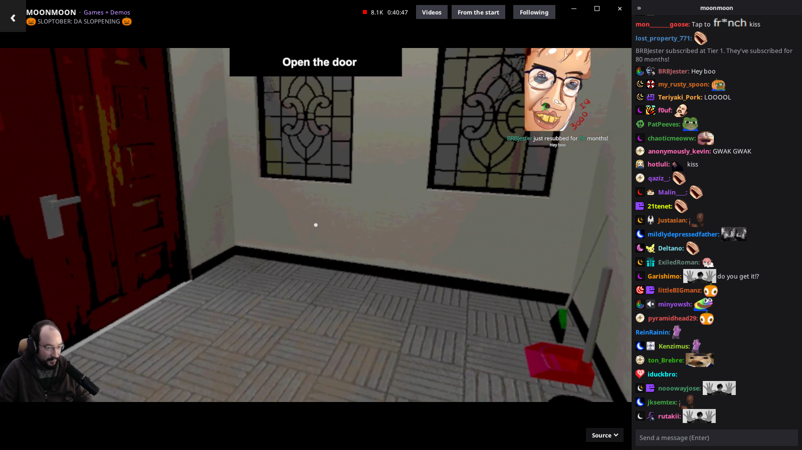
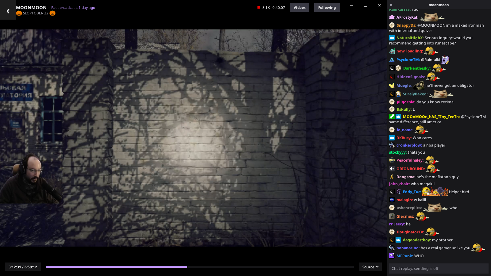
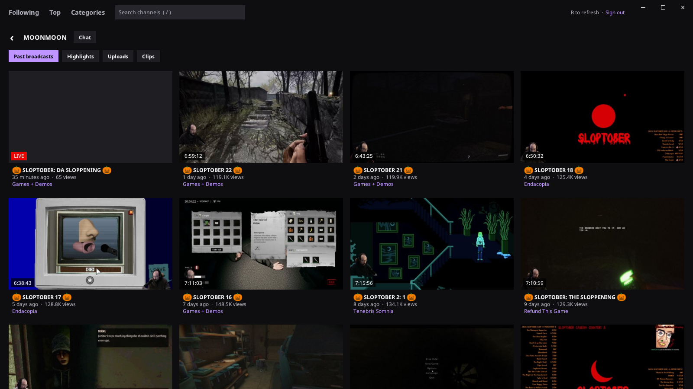
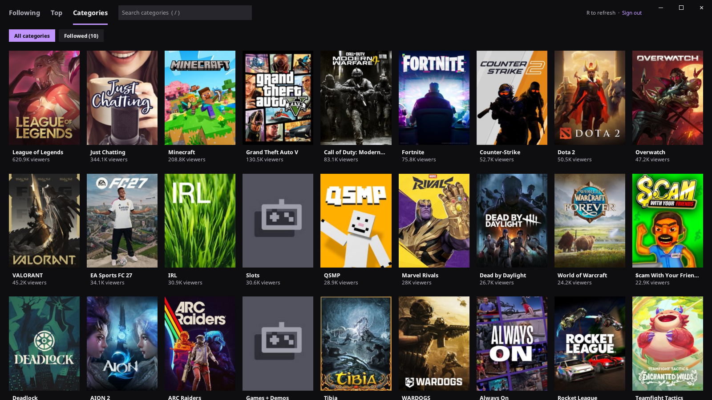

<p align="center">
  
</p>

<h1 align="center">Lurker</h1>

A native desktop client for watching Twitch, on Linux and Windows. Streams play
through mpv, alongside a Chatterino-style chat, with no browser involved.

Video goes through streamlink, which drops ad segments, so streams play without
pre-roll or mid-roll ads.



<p>
  
  
  
</p>

## Features

- Browse followed channels (live and offline), top streams and categories, and
  search channels and categories
- Chat with 7TV, BTTV and FFZ emotes, badges, replies and an emote picker; open
  other channels' chats as splits beside the video
- Mentions are highlighted, with a count of unread ones on each chat
- Hover a stream card for its full title, or an emote or badge for its name
- Each channel's past broadcasts, highlights, uploads and clips, with chat replay,
  chapters, seek-bar previews, playback speed, and resuming where you left off
- Watch a live stream from its start, then jump back to live
- Quality selection, low-latency mode, volume boost up to 130%
- Follow and unfollow channels
- A desktop notification when a channel you follow goes live, while Lurker is
  open, with its picture; click it to watch, or turn them off at the top
- Remembers volume, quality, splits, chat visibility and text size

## Flatpak

The Flatpak bundles everything Lurker needs, including mpv and streamlink.
Download `lurker-<version>-x86_64.flatpak` from the
[latest release](https://github.com/sp1r17/lurker/releases/latest) and install it:

```sh
flatpak install --user lurker-0.2.2-x86_64.flatpak
flatpak run io.github.sp1r17.Lurker
```

Flatpak fetches the runtime it needs from Flathub. Updates aren't automatic:
install a newer release's file the same way.

To build and install it yourself instead:

```sh
flatpak install --user flathub org.flatpak.Builder
flatpak run org.flatpak.Builder --user --install-deps-from=flathub --install \
    --force-clean build/flatpak packaging/flatpak/io.github.sp1r17.Lurker.yml
flatpak run io.github.sp1r17.Lurker
```

The first build compiles Odin, mpv and their dependencies, and takes a while.

## Windows

Download `lurker-<version>-x86_64-setup.exe` from the
[latest release](https://github.com/sp1r17/lurker/releases/latest) and run it. It
includes mpv and streamlink, and installs for the current user unless you choose
otherwise.

The Windows version is new and hasn't had much testing yet. If something doesn't
work, please [open an issue](https://github.com/sp1r17/lurker/issues).

To build it, run `packaging\windows\build.ps1` from an "x64 Native Tools" prompt
with Odin on the PATH. It downloads libmpv and streamlink, and makes the installer
if Inno Setup is installed.

## Building on Linux

To build and install without Flatpak, you need:

- [mpv](https://mpv.io) (libmpv), SDL3, SDL3_image, libcurl, fontconfig and Wayland
- [streamlink](https://streamlink.github.io)
- [Odin](https://odin-lang.org), a recent build, to compile

On Fedora:

```sh
sudo dnf install mpv-libs SDL3 SDL3_image libcurl fontconfig libwayland-client streamlink
```

For Japanese, Chinese and Korean text, install Noto Sans CJK
(`google-noto-sans-cjk-fonts` on Fedora, `noto-fonts-cjk` on Arch,
`fonts-noto-cjk` on Debian and Ubuntu).

Then:

```sh
./install.sh
```

This builds a release and installs it to `~/.local`, with an entry and icon in
the application menu. Use `--prefix <dir>` to install elsewhere, or `--uninstall`
to remove it.

To build without installing, run `./build.sh release`. The binary is written to
`build/lurker`.

## Usage

```sh
lurker                      # browse the channels you follow
lurker <channel>...         # watch a channel, with any others' chats as splits
lurker <video or clip link> # e.g. https://twitch.tv/videos/123?t=1h2m
lurker --login              # sign in from the terminal
```

Signing in is optional, but needed for followed channels, chatting and
following. It uses Twitch's device code flow: Lurker shows a code to enter at
twitch.tv/activate, so no password is typed into the app. The sign-in and
settings are stored in `~/.config/lurker` (`%APPDATA%\lurker` on Windows).

## Keyboard shortcuts

| Key | Action |
| --- | --- |
| Space | Pause |
| M | Mute |
| Up / Down | Volume |
| Left / Right | Seek 10 seconds (videos) |
| [ / ] | Slower / faster (videos) |
| Page Up / Page Down | Previous / next chapter |
| Home | Start a resumed video over |
| F, or double-click the video | Fullscreen |
| C | Show or hide chat |
| Enter | Chat in the focused split, or play an offline channel's last broadcast |
| Ctrl+T / Ctrl+W | Open / close a chat split |
| Ctrl+F | Search the chat, or channels when browsing |
| / | Search channels |
| R | Refresh |
| Ctrl+= / Ctrl+- / Ctrl+0, or Ctrl+scroll | Text size |
| Esc, or the mouse's back button | Back |
| Q | Quit |

In chat, Tab completes emote and user names, `:` followed by part of a name opens
the emote picker, and right-clicking a message replies to it.

## Configuration

By default Lurker signs in with the client ID of Twitch's Android TV app, so no
application needs to be registered with Twitch. To use your own, set
`TWITCH_CLIENT_ID` or add it to `config.json` beside the sign-in:

```json
{ "client_id": "your-client-id" }
```

Some features use Twitch's internal GraphQL API, which Twitch can change without
notice: following, followed categories, offline channels, past broadcasts and
chat replay, and your own Twitch emotes in the picker.

## License

Lurker is released under the [MIT License](LICENSE). The Flatpak and the Windows
installer also contain mpv, streamlink and other libraries under their own
licenses, some of them GPL.

Text is set in [Noto Sans](https://fonts.google.com/noto/specimen/Noto+Sans),
licensed under the SIL Open Font License (`assets/fonts/noto_sans/OFL.txt`).

Lurker is not affiliated with or endorsed by Twitch.
