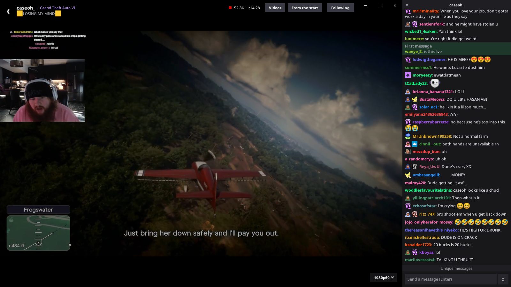
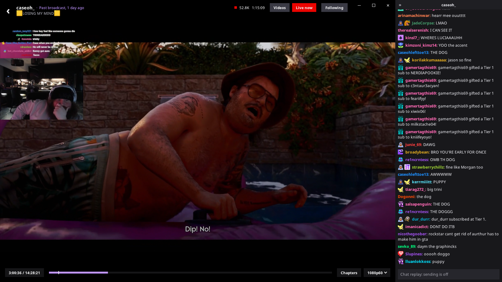
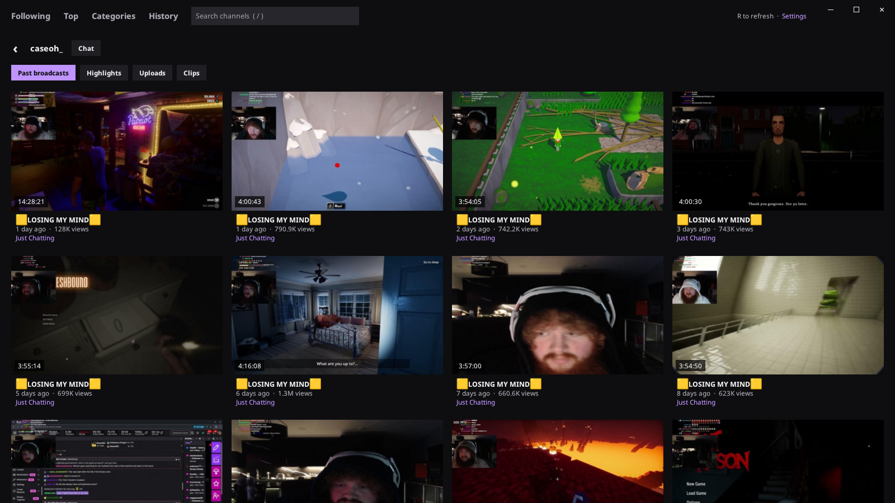
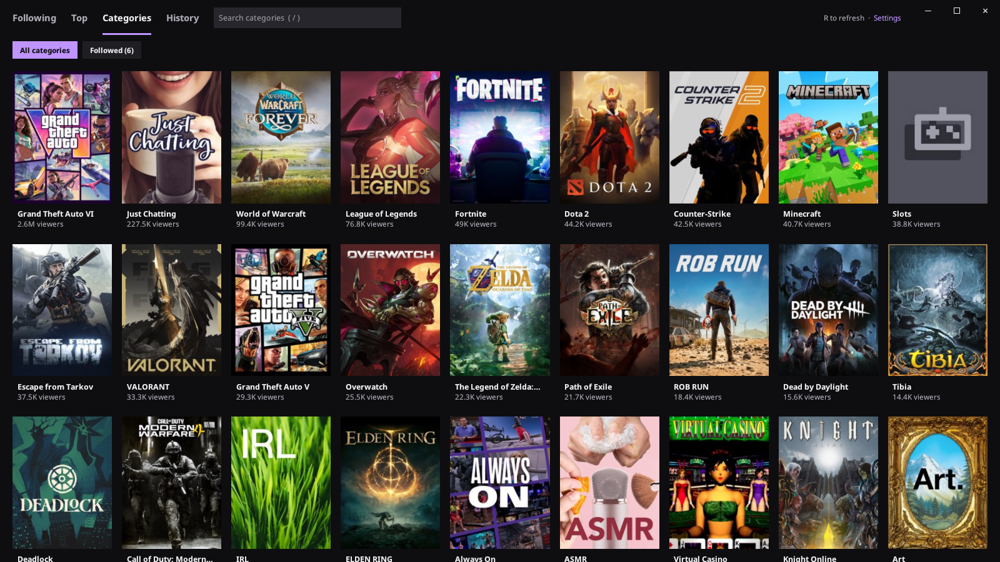

<p align="center">
  
</p>

<h1 align="center">Lurker</h1>

A native desktop client for watching Twitch, on Linux, Windows and macOS. Streams play
through mpv, alongside a Chatterino-style chat, with no browser involved.

Video goes through streamlink, which drops ad segments, so streams play without
pre-roll or mid-roll ads.



<p>
  
  
  
</p>

## Features

- Browse followed channels (live and offline), top streams and categories, and
  search channels and categories
- Chat with 7TV, BTTV and FFZ emotes, badges, replies and an emote picker; open
  other channels' chats as splits beside the video
- Recent chat history on joining, clickable links, reply threads (click a reply's
  "Replying to" line), and the chat's modes (slow, subscribers only...) above the
  chat box
- Mentions are highlighted, with a count of unread ones on each chat, and can
  play a sound or flash Lurker in the taskbar; add your own highlight phrases and
  hide people's messages, in Settings or with `/highlight` and `/ignore`
- User cards with everything someone said in the chat; moderators can time out,
  ban and delete from them, or with `/timeout`, `/ban` and `/clear`
- Whispers show in the chat you're watching; send one with `/w name message`
- Hover a stream card for its full title, or an emote or badge for its name
- Sort streams by viewers, start time, name or category; live cards show how
  long the stream has been live
- A History tab with the streams, videos and clips you've watched
- Each channel's past broadcasts, highlights, uploads and clips, with chat replay,
  chapters, seek-bar previews, playback speed, and resuming where you left off
- Watch a live stream from its start, then jump back to live
- The stream's exact qualities (936p, say), an optional highest quality, low
  latency with an optional buffer, and volume boost up to 130%
- Stream stats (press I): resolution, bitrate, network speed, buffer, dropped
  frames, ping to Twitch and latency to the broadcaster
- Chat can be delayed to match the stream; timestamps, highlighted streamer and
  moderator messages, hidden bots and alternating backgrounds are in Settings
- Follow and unfollow channels and categories, from the stream or by
  right-clicking a card
- Block channels and categories (right-click a card, or in Settings) to hide them
  everywhere
- Pick a primary language in Settings: streams in other languages on Top and in
  categories are grayed out or hidden
- Follows the channel you're watching when it raids another (switch it off in
  Settings or the quality menu)
- Signed in, watching a live stream earns channel points, as on Twitch's site:
  Lurker tells Twitch each minute you watch (not while paused or buffering).
  Switch it off in Settings
- On Linux and Windows, a desktop notification when a channel you follow goes
  live, while Lurker is open, with its picture; click it to watch. Mute
  channels, or only notify for the ones you choose, in Settings or by
  right-clicking
- Remembers volume, quality, splits, chat visibility, text size and language
- Tells you when a new version is out (turn it off in Settings); on Windows, it
  updates itself

## Install

Lurker runs on Linux and Windows on x86-64, and on Macs with Apple silicon.
There are no ARM builds for Linux or Windows.

## Flatpak

The Flatpak bundles everything Lurker needs, including mpv and streamlink.
Install it from Lurker's Flatpak repository:

```sh
flatpak install --user https://sp1r17.github.io/lurker/lurker.flatpakref
flatpak run io.github.sp1r17.Lurker
```

Flatpak fetches the runtime it needs from Flathub, and `flatpak update` (or your
software center) keeps Lurker up to date. Each
[release](https://github.com/sp1r17/lurker/releases/latest) also has a
`lurker-<version>-x86_64.flatpak` file, which installs the same way
(`flatpak install --user lurker-<version>-x86_64.flatpak`) and gets updates from
the repository too.

If you installed 0.10.0 or older from a file, Flatpak won't install over it from
the repository. Uninstall it first; your settings and sign-in are kept:

```sh
flatpak uninstall --user io.github.sp1r17.Lurker
flatpak install --user https://sp1r17.github.io/lurker/lurker.flatpakref
```

To build and install it yourself instead:

```sh
flatpak install --user flathub org.flatpak.Builder
flatpak run org.flatpak.Builder --user --install-deps-from=flathub --install \
    --force-clean build/flatpak packaging/flatpak/io.github.sp1r17.Lurker.yml
flatpak run io.github.sp1r17.Lurker
```

The first build compiles Odin, mpv and their dependencies, and takes a while.

## Windows

Download `lurker-<version>-x86_64-setup.exe` from the
[latest release](https://github.com/sp1r17/lurker/releases/latest) and run it. It
includes mpv and streamlink, and installs for the current user unless you choose
otherwise.

The Windows version is new and hasn't had much testing yet. If something doesn't
work, please [open an issue](https://github.com/sp1r17/lurker/issues).

To build it, run `packaging\windows\build.ps1` from an "x64 Native Tools" prompt
with Odin on the PATH. It downloads libmpv and streamlink, and makes the installer
if Inno Setup is installed.

## macOS

Download `lurker-<version>-arm64.dmg` from the
[latest release](https://github.com/sp1r17/lurker/releases/latest), open it and
drag Lurker to Applications. It includes mpv and streamlink.

It needs a Mac with Apple silicon (M1 and later) and macOS 26 or later; there's
no Intel version. The app isn't signed by Apple, so macOS won't open it the first
time: after trying, click Open Anyway in System Settings → Privacy & Security.
There are no live notifications on macOS: they'd need the app signed by Apple.

The macOS version is new and hasn't had much testing yet. If something doesn't
work, please [open an issue](https://github.com/sp1r17/lurker/issues).

To build it, install Odin and Homebrew, then:

```sh
brew install sdl3 sdl3_image mpv curl dylibbundler
packaging/macos/build.sh
```

This makes `build/macos/Lurker.app`, with mpv and streamlink inside, and a disk
image holding it. The app needs the macOS version it was built on, or later.

## Building on Linux

To build and install without Flatpak, you need:

- [mpv](https://mpv.io) (libmpv), SDL3, SDL3_image, libcurl, fontconfig and Wayland
- [streamlink](https://streamlink.github.io)
- [Odin](https://odin-lang.org), a recent build, to compile

On Fedora:

```sh
sudo dnf install mpv-libs SDL3 SDL3_image libcurl fontconfig libwayland-client streamlink
```

For Japanese, Chinese and Korean text, install Noto Sans CJK
(`google-noto-sans-cjk-fonts` on Fedora, `noto-fonts-cjk` on Arch,
`fonts-noto-cjk` on Debian and Ubuntu).

Then:

```sh
./install.sh
```

This builds a release and installs it to `~/.local`, with an entry and icon in
the application menu. Use `--prefix <dir>` to install elsewhere, or `--uninstall`
to remove it.

To build without installing, run `./build.sh release`. The binary is written to
`build/lurker`.

## Usage

```sh
lurker                      # browse the channels you follow
lurker <channel>...         # watch a channel, with any others' chats as splits
lurker <video or clip link> # e.g. https://twitch.tv/videos/123?t=1h2m
lurker --login              # sign in from the terminal
```

Signing in is optional, but needed for followed channels, chatting and
following. It uses Twitch's device code flow: Lurker shows a code to enter at
twitch.tv/activate, so no password is typed into the app. The sign-in and
settings are stored in `~/.config/lurker` (`%APPDATA%\lurker` on Windows).

## Keyboard shortcuts

| Key | Action |
| --- | --- |
| Space | Pause |
| M | Mute |
| Up / Down | Volume |
| Left / Right | Seek 10 seconds (videos) |
| [ / ] | Slower / faster (videos) |
| , / . | A frame back / on, paused (videos) |
| Page Up / Page Down | Previous / next chapter |
| Home | Start a resumed video over |
| F | Fullscreen |
| Double-click the video or the top bar | Fullscreen / back |
| C | Show or hide chat |
| O | Chat over the video, or beside it |
| I | Show or hide the stream stats |
| S | Screenshot of the video, saved in Pictures/Lurker |
| R | Refresh (or start a frozen stream again) |
| Enter | Chat in the focused split, or play an offline channel's last broadcast |
| Ctrl+T / Ctrl+W | Open / close a chat split |
| Ctrl+, | Settings (when browsing) |
| Ctrl+F | Search the chat, or channels when browsing |
| / | Search channels |
| Ctrl+= / Ctrl+- / Ctrl+0, or Ctrl+scroll | Text size |
| Esc, or the mouse's back button | Back |
| ? | This list, in the app |
| Q | Quit |

On macOS, use Cmd instead of Ctrl, and Option+Left / Right to move by word.

In chat, Tab completes emote and user names, `:` followed by part of a name opens
the emote picker, and right-clicking a message replies to it.

## Configuration

By default Lurker signs in with the client ID of Twitch's Android TV app, so no
application needs to be registered with Twitch. To use your own, set
`TWITCH_CLIENT_ID` or add it to `config.json` beside the sign-in:

```json
{ "client_id": "your-client-id" }
```

Some features use Twitch's internal GraphQL API, which Twitch can change without
notice: following, followed categories, offline channels, past broadcasts and
chat replay, and your own Twitch emotes in the picker.

## Reporting bugs

Please [open an issue](https://github.com/sp1r17/lurker/issues/new/choose) with
Lurker's log: Settings → Bug reports → Copy log copies it, along with the log of
the run before, for when Lurker crashed. The logs are `lurker.log` and
`lurker.old.log` in `~/.cache/lurker` (in the Flatpak,
`~/.var/app/io.github.sp1r17.Lurker/cache/lurker`), `%LOCALAPPDATA%\lurker` on
Windows and `~/Library/Caches/lurker` on macOS.

## License

Copyright © 2026 spirit. Lurker is free software, released under the
[GNU General Public License, version 3](LICENSE) or (at your option) any later
version. You may share, change and even sell it, as long as everyone who gets a
copy also gets its source code under the same license. Versions up to 0.7.0 were
released under the MIT License.

The Flatpak, the Windows installer and the macOS app also contain mpv,
streamlink and other libraries under their own licenses, some of them GPL.

### The name and icon

The name "Lurker" and its icon aren't covered by the license. If you share a
changed version of Lurker, give it a different name and icon, and don't present
it as the official Lurker or as made by its author. Copies of official releases,
unchanged, can keep both.

Text is set in [Noto Sans](https://fonts.google.com/noto/specimen/Noto+Sans),
licensed under the SIL Open Font License (`assets/fonts/noto_sans/OFL.txt`).

Lurker is not affiliated with or endorsed by Twitch.
